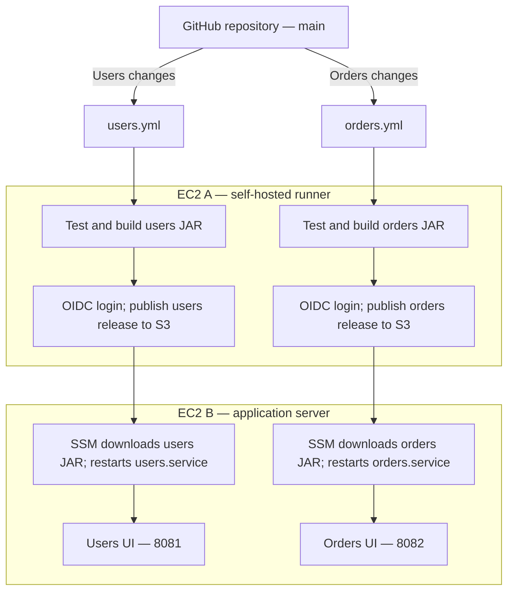

# Two microservices · two pipelines · two EC2 machines

Two tiny Java 17 / Spring Boot applications, each with its own browser UI,
Maven build, GitHub Actions workflow, JAR, systemd service, and deployment.
Use one repository and a shared `main` branch.

**Start with [docs/SETUP.md](docs/SETUP.md).** It walks through the two EC2 machines,
S3, IAM/OIDC, runner registration, repository variables, and your first deployment.

| Item | Users | Orders |
| --- | --- | --- |
| Source | `users-service/` | `orders-service/` |
| Workflow | `.github/workflows/users.yml` | `.github/workflows/orders.yml` |
| Build output | `users-service/target/users-service.jar` | `orders-service/target/orders-service.jar` |
| Browser UI | `http://APP_PUBLIC_IP:8081/` | `http://APP_PUBLIC_IP:8082/` |
| JSON endpoint | `/api/hello` | `/api/hello` |
| Health endpoint | `/health` | `/health` |
| systemd unit | `users.service` | `orders.service` |

Each UI has a **Call this service** button that calls that application's own API.
The applications use sample greetings and do not call one another. They are
intentionally small so you can concentrate on independent service delivery.

## Architecture



## Try the apps locally

Install a JDK 17 and Maven 3.6.3 or newer. From the repository root:

```bash
mvn -B -f users-service/pom.xml clean verify
java -jar users-service/target/users-service.jar
```

In a second terminal:

```bash
mvn -B -f orders-service/pom.xml clean verify
java -jar orders-service/target/orders-service.jar
```

Open <http://localhost:8081/> and <http://localhost:8082/>.
Stop each application with `Ctrl+C`. Each service builds independently; there is
no root Maven build combining the applications.

## Pipeline behavior

| Event | Result |
| --- | --- |
| PR into `main` changing users | Test and build users only; no AWS authentication or deployment |
| Push/merge into `main` changing users | Test, build, publish, and deploy users only |
| Push/merge into `main` changing orders | Test, build, publish, and deploy orders only |
| Change both service folders | Both workflows run |
| Change shared deployment scripts | Both workflows run |
| Actions → selected workflow → Run workflow → `main` | Build and deploy that service manually |
| Manual run from another branch | Job skipped |
| README/docs-only change | No automatic application workflow |

Use temporary feature branches and PRs. You do not need permanent service-specific
branches. One runner registration processes one job at a time, so the workflows
queue when both need the runner. Deployment concurrency is also scoped per service.

## What is included

- Two minimal Java applications and two distinct HTML UIs.
- HTTP integration tests for each UI, API, and health endpoint.
- Two separate GitHub Actions workflows with service-specific path filters.
- Ubuntu setup scripts for the runner and application server.
- IAM policy templates and a local template-rendering script.
- S3 artifact publication, checksum verification, SSM status polling, systemd deployment,
  and rollback to the previous local JAR if startup or health checks fail.
- [Setup and troubleshooting](docs/SETUP.md) and [manual rollback](docs/OPERATIONS.md).

JARs are built by the workflows, rather than bundled in this source ZIP. The EC2
machines, bucket, roles, and runner must be configured before deployment can run.
This is a learning deployment on one application VM; releases briefly restart
the selected service. Production high availability and zero-downtime deployment
would require additional infrastructure.

## Reference documentation

- [GitHub OIDC with AWS](https://docs.github.com/en/actions/how-tos/secure-your-work/security-harden-deployments/oidc-in-aws)
- [Workflow path filters](https://docs.github.com/en/actions/reference/workflows-and-actions/workflow-syntax#onpushpull_requestpull_request_targetpathspaths-ignore)
- [Self-hosted runner registration](https://docs.github.com/en/actions/how-tos/manage-runners/self-hosted-runners/add-runners)
- [AWS Systems Manager Run Command](https://docs.aws.amazon.com/systems-manager/latest/userguide/run-command.html)
- [SSM Agent on Ubuntu](https://docs.aws.amazon.com/systems-manager/latest/userguide/agent-install-ubuntu.html)
- [Spring Boot system requirements](https://docs.spring.io/spring-boot/system-requirements.html)
